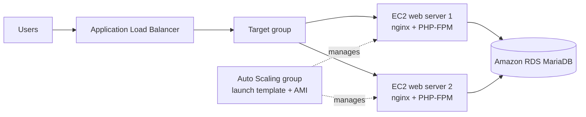

# AWS Scalable Web Architecture

A dynamic PHP + MariaDB website, first deployed on a single EC2 instance,
then moved to a scalable architecture: database on Amazon RDS, web servers
behind an Application Load Balancer with Auto Scaling.

Built in an AWS Academy Learner Lab (region `us-east-1`), using only the
AWS Management Console.

## Architecture

## Stages
1. **Single server:** EC2 instance (Amazon Linux 2023) running nginx, PHP-FPM and MariaDB.
2. **Managed database:** data migrated to Amazon RDS; the site connects to it over SSL.
3. **Custom AMI:** image of the configured web server.
4. **Scalability:** launch template, target group, Application Load Balancer and Auto Scaling group.
5. **Load test:** Apache Bench (`ab`) against the load balancer.

## Security groups
Separate groups for the load balancer, the web servers and the database;
the database only accepts traffic from the web servers.

## Screenshots
Add yours in an `images/` folder (hide account IDs and keys):
- Architecture overview
- Load balancer and target group
- Auto Scaling group
- Load test result

## Tech
AWS EC2 · RDS · ALB · Auto Scaling · nginx · PHP-FPM · MariaDB · Apache Bench
